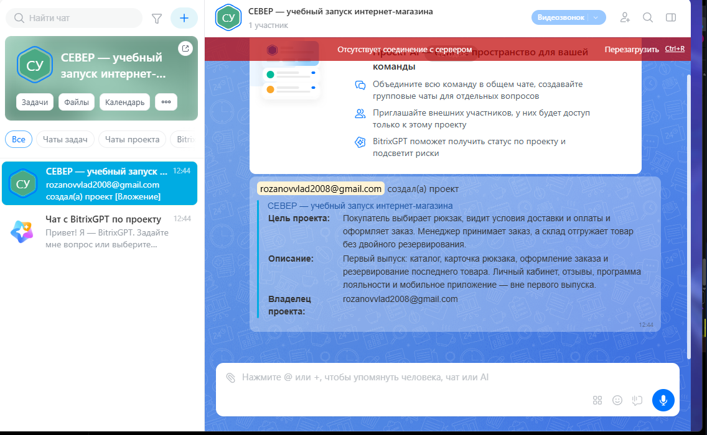
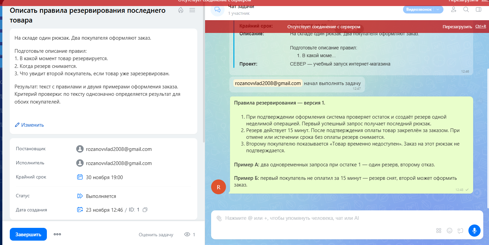
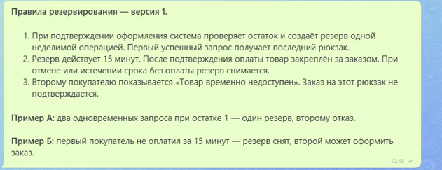
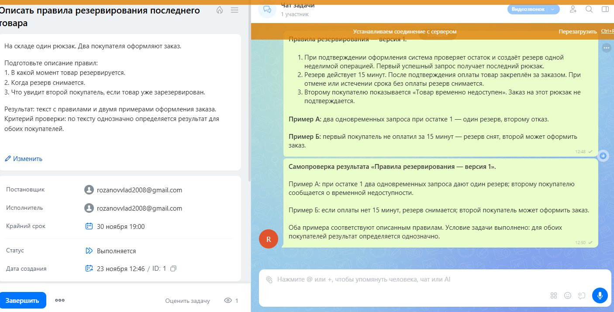

# Отчёт по теме 2. Проект, задача и результат

Репозиторий: https://github.com/fLORIN-org/project-management

Проект: https://b24-1b230t.bitrix24.ru/workgroups/group/1/

Задача 1: https://b24-1b230t.bitrix24.ru/company/personal/user/1/tasks/task/view/1/

Задача 2: https://b24-1b230t.bitrix24.ru/company/personal/user/1/tasks/task/view/3/

Задача 3: https://b24-1b230t.bitrix24.ru/company/personal/user/1/tasks/task/view/5/

## Скриншоты

### 1. Проект: название, цель и границы

[Открыть скриншот](screenshots/01-project.png)

### 2. Условия первой задачи

[Открыть скриншот](screenshots/02-task-reservation.png)

### 3. Результат: правила и два примера

[Открыть скриншот](screenshots/03-result.png)

### 4. Самопроверка или отзыв

[Открыть скриншот](screenshots/04-review.png)

### 5. Завершённая первая задача

[Открыть скриншот](screenshots/05-completed.png)

### 6. Условия задачи о карточке товара

[Открыть скриншот](screenshots/06-task-product-card.png)

### 7. Условия задачи о проверках

[Открыть скриншот](screenshots/07-task-checks.png)

