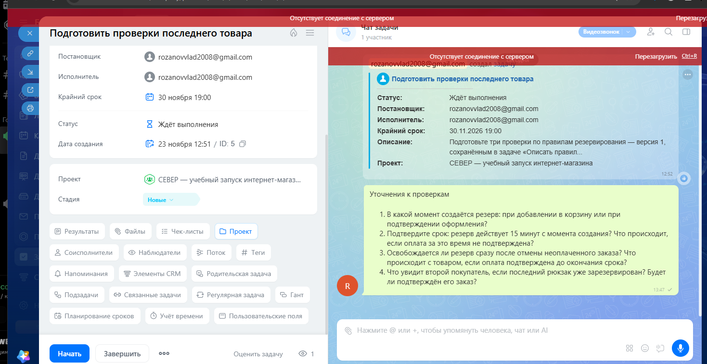
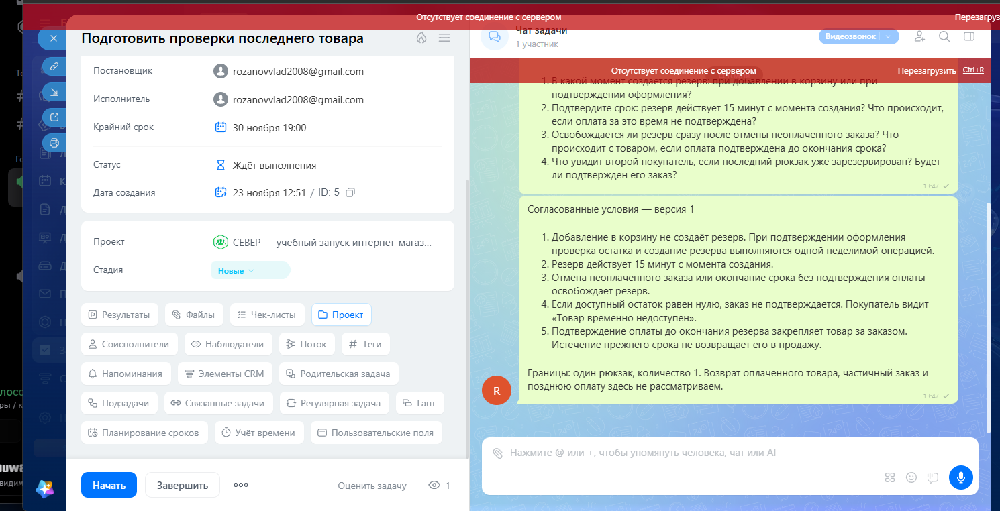
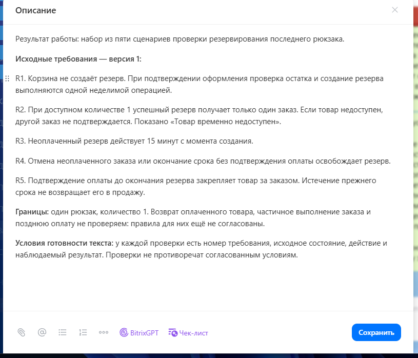
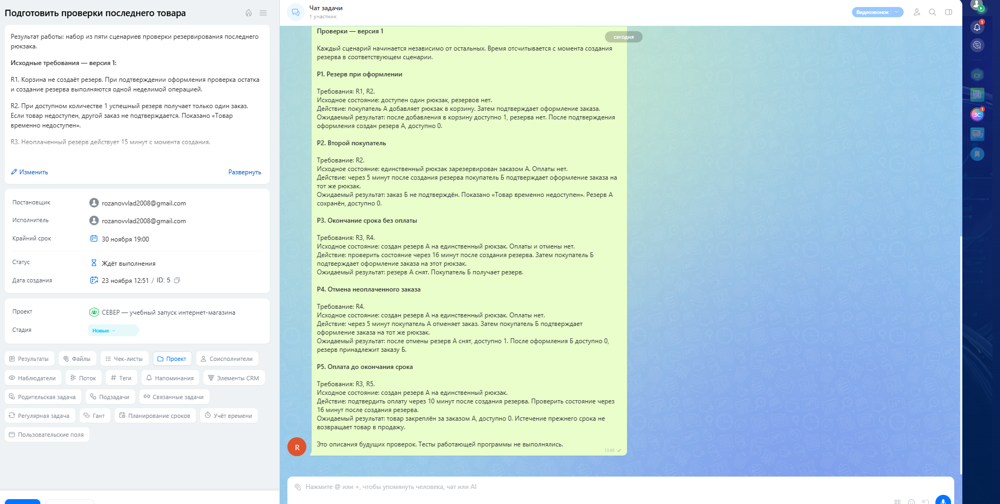
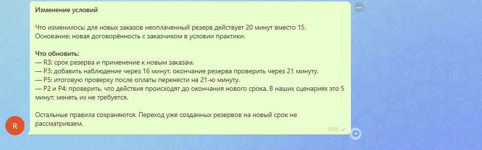
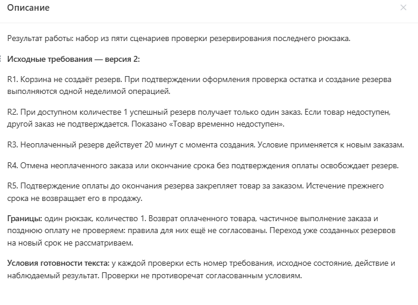
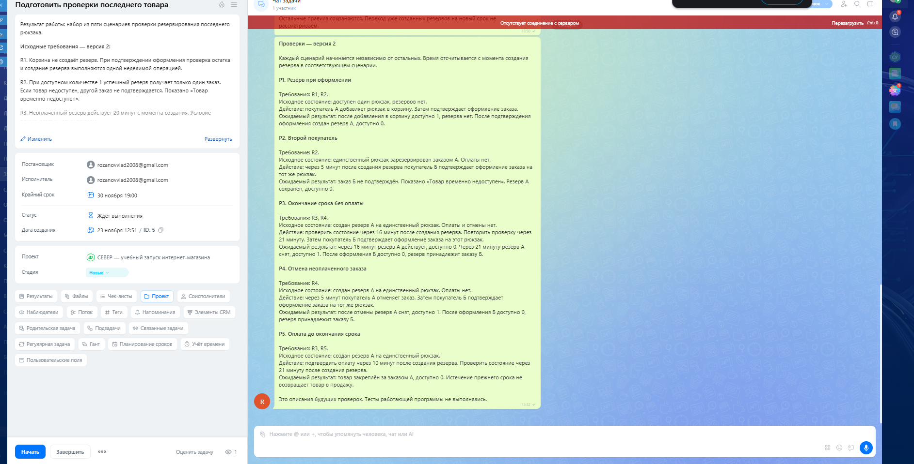
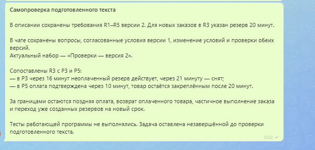

# Отчёт. Уточняем требования

Репозиторий: [project-management](https://github.com/fLORIN-org/project-management)

Проект: [СЕВЕР — учебный запуск интернет-магазина](https://b24-1b230t.bitrix24.ru/workgroups/group/1/)

Задача: [Подготовить проверки последнего товара](https://b24-1b230t.bitrix24.ru/company/personal/user/1/tasks/task/view/5/)

## Скриншоты

### 1. Вопросы в чате

### 2. Согласованные условия — версия 1

### 3. Описание задачи — версия 1

### 4. Проверки P1–P5 — версия 1

### 5. Изменение срока

### 6. Описание задачи — версия 2

### 7. Проверки P1–P5 — версия 2

### 8. Итог после самопроверки

